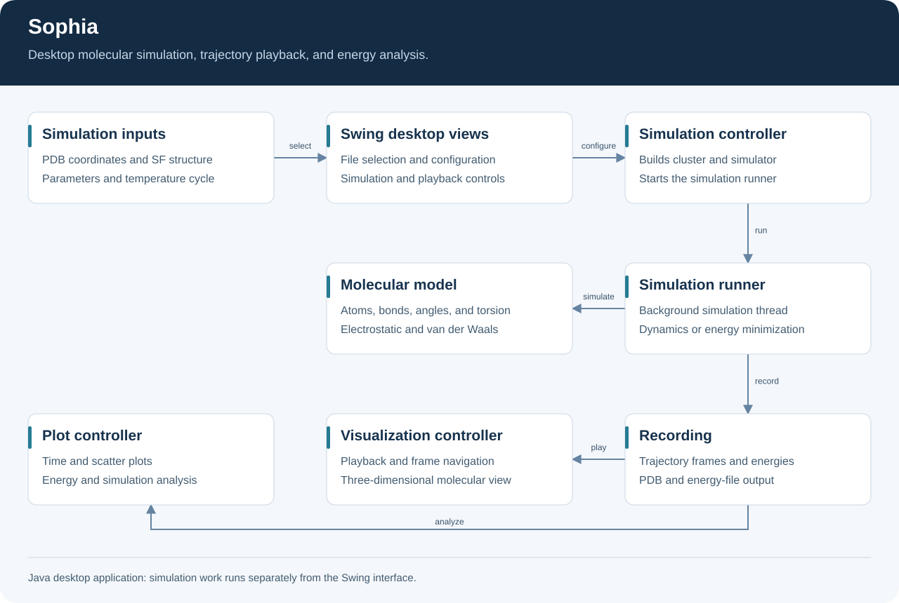

# Architecture

Desktop molecular simulation, trajectory playback, and energy analysis.

Java desktop application: simulation work runs separately from the Swing interface.

## Implementation references

- [src/Controllers/SimulationController.java](../src/Controllers/SimulationController.java)
- [src/Models/SimulationRunner.java](../src/Models/SimulationRunner.java)
- [src/Models/Cluster.java](../src/Models/Cluster.java)
- [src/Models/Recording.java](../src/Models/Recording.java)
- [src/Views/PlaybackView.java](../src/Views/PlaybackView.java)
- [src/Controllers/PlotController.java](../src/Controllers/PlotController.java)

## Project overview

[Portfolio project page](https://johnbieniek.com/projects/sophia)
